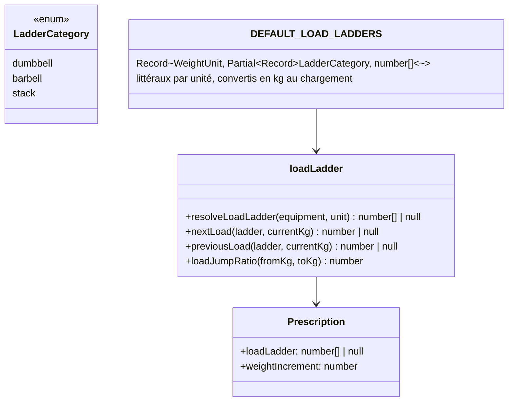
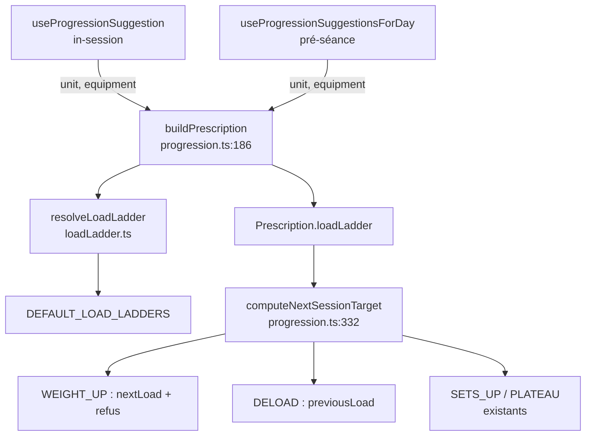

# Tech Plan — Charge réelle en salle : l'échelle de charges (P4)

## Architectural Approach

### Key Decisions

| Decision | Choice | Rationale |
|---|---|---|
| Où vit l'échelle | Un module **pur** neuf, `file:src/lib/loadLadder.ts` — constantes + résolution + pas | Aucune donnée utilisateur à stocker : les défauts sont du code, comme `DEFAULT_INCREMENT` (`file:src/lib/rirSuggestion.ts:42`) |
| Unité | Défauts écrits **par unité** (kg / lbs), **canonique kg** en interne | 5 lb est le vrai pas d'une salle lbs ; convertir une échelle kg donne des paliers bâtards |
| Override par exercice | **Hors v1** — défauts seuls | Une liste demande une colonne + un champ de saisie : ni l'une ni l'autre n'existe sans élargir le chantier. Le défaut corrige le cas courant pour tout le monde |
| Résolveur d'incrément | Le nouveau **remplace** `resolveWeightIncrement` pour le moteur inter ; l'ancien survit en repli privé | Un seul concept à lire ; l'ancien nom reste, en fonction de dernier recours |
| Échelle barre | **Littéral documenté** | La supposition est écrite noir sur blanc et se remplace quand on saura, sans changer le modèle |
| Appariement | Tolérance **0,1 kg**, on prescrit le **cran exact** | Absorbe l'arrondi d'affichage lbs (45 lb ≈ 20,4 kg) sans confondre deux crans de 5 lb (2,27 kg) |
| Pas de la pile | **5 kg** (10 lb) au lieu de 2,5 kg | C'est le pas réel d'une pile à goupille : prescrire 2,5 kg sur une machine, c'est le bug annoncé |
| Refus du saut | `SETS_UP` **silencieux** (clé existante `progression.setsUp`) | 0 clé i18n ; une série en plus est une progression qui se comprend seule |
| Entrée de `unit` | Par les `opts` de `buildPrescription` / `computeNextSessionTarget`, défaut `"kg"` | Les appelants non mis à jour et tous les tests existants gardent leur comportement |
| Sortie quand tout est maxé | `PLATEAU` (terminal existant) → **Stall** → **Deload** de P2 | Aucune sortie nouvelle : P4 alimente l'escalade, il n'en invente pas |

### Critical Constraints

**Un seul seam.** La règle reste pure : `buildPrescription` résout l'échelle **une fois** et la porte dans
la `Prescription` (`loadLadder: number[] | null`). `computeNextSessionTarget` ne connaît ni l'unité ni la
base de données — il lit `prescription.loadLadder`. Deux appelants seulement :
`file:src/hooks/useProgressionSuggestion.ts:48` (in-session) et
`file:src/hooks/useProgressionSuggestionsForDay.ts:108` (pré-séance) ; les deux reçoivent `unit` via
`useWeightUnit()` (`file:src/hooks/useWeightUnit.ts:9`).

**`prescribed_*` reste pristine.** P4 change la charge **suggérée**, jamais la sémantique du
**Prescription Snapshot** (ADR 0006) : la valeur écrite au premier log est l'intention de la séance,
l'observatoire de déviations garde sa baseline. C'est un changement de valeur, pas de contrat.

**Le moteur intra-séance n'est pas touché.** `computeCascadeSuggestions`
(`file:src/components/workout/SetsTable.tsx:561`) est unit-aware depuis toujours (`resolveIncrement`,
`file:src/lib/rirSuggestion.ts:64`) et opère sur les **valeurs affichées**. P4 travaille sur l'autre seam.
Les échelles par défaut sont choisies pour que **leurs pas coïncident** avec les incréments existants
(kg haltères 2, kg barre 2,5, lbs 5) — les deux moteurs ne se contredisent pas là où ils se recouvrent.

**`weightIncrement` reste le filet.** Il sert encore de repli quand aucune échelle n'existe et de
**plancher** pour la Décharge (`file:src/lib/progression.ts:386` :
`Math.max(weightIncrement, currentWeight - weightIncrement)`). On ne le retire pas.

**La barre est un pari assumé.** Son échelle par défaut est une **supposition** (un jeu de disques
standard), documentée comme telle — pas la salle de l'athlète. Même statut que `LOAD_JUMP_MAX_RATIO` et
`STALL_SESSIONS` : valeur de départ, à recalibrer quand l'observatoire aura de la matière
(`progression_rule_served` = 0 ligne au 21/10).

---

## Data Model

Aucun changement de schéma : **0 migration**. Le modèle est en mémoire.



### Table Notes

| Élément | Note |
|---|---|
| **Catégorie d'échelle** | Quatre slugs de `EQUIPMENT_TAXONOMY` (`file:src/lib/catalogTaxonomy.ts:9`) se mappent sur trois échelles : `dumbbell` + `kettlebell` → haltères ; `barbell` + `ez_bar` → barre ; `machine` + `cable` → pile. `bench`, `bodyweight`, `band`, `other` → **aucune échelle** (repli sur l'incrément hérité). |
| **Unité canonique** | Les littéraux sont lisibles dans leur unité ; le module exporte la version **kg**. Un cran de 45 lb vaut 20,4116 kg — c'est cette valeur qui est prescrite et stockée, et l'affichage la rend 45,0. |
| **Appariement** | `nextLoad` cherche le premier cran **strictement supérieur** à `currentKg`, à **0,1 kg** près, pour absorber l'arrondi d'affichage (`toDisplay` rend 1 décimale en lbs, `file:src/hooks/useWeightUnit.ts:26`). Sans tolérance, un 20,4 kg stocké ne reconnaîtrait pas son propre cran. |
| **Repli** | Hors échelle, au-dessus du dernier cran, ou aucune échelle → `nextLoad` rend `null` → le moteur reprend `currentWeight + weightIncrement`. Aucun blocage, aucun saut absurde. |
| **Pile (machine/câble)** | Pas de **5 kg** (au lieu des 2,5 kg actuels) : c'est le pas réel d'une pile à goupille. Changement de comportement assumé, visible pour les athlètes machine. |

```ts
export const LOAD_JUMP_MAX_RATIO = 0.30

// Un jeu de disques standard : barre 20 kg, disques 1,25 / 2,5 / 5 / 10 / 20 en paires.
// Les totaux atteignables qui en découlent, arrêtés à 120 kg — la liste est une
// supposition documentée, pas la salle de l'athlète (voir Critical Constraints).
export const DEFAULT_LOAD_LADDERS: Record<WeightUnit, Partial<Record<LadderCategory, number[]>>> = {
  kg: {
    dumbbell: [2, 4, 6, 8, 10, 12, 14, 16, 18, 20, 25, 30, 35, 40, 45, 50],
    barbell:  [20, 22.5, 25, 27.5, 30, 32.5, 35, 37.5, 40, 45, 50, 55, 60, 70, 80, 90, 100, 110, 120],
    stack:    [5, 10, 15, 20, 25, 30, 35, 40, 45, 50, 60, 70, 80, 90, 100],
  },
  lbs: {
    dumbbell: [5, 10, 15, 20, 25, 30, 35, 40, 45, 50, 60, 70, 80, 90, 100],
    barbell:  [45, 50, 55, 65, 75, 85, 95, 115, 135, 155, 185, 205, 225, 245, 275, 315],
    stack:    [10, 20, 30, 40, 50, 60, 70, 80, 90, 100, 120, 140, 160],
  },
}
```

### La branche `WEIGHT_UP` réécrite

```ts
if (!maxWeightReached) {
  const ladderNext = loadLadder ? nextLoad(loadLadder, currentWeight) : null

  // Hors échelle, au-dessus du dernier cran, ou aucune échelle : on ne refuse pas,
  // on retombe sur le pas hérité (jamais de blocage, jamais de saut inventé).
  if (ladderNext == null) {
    return makeSuggestion("WEIGHT_UP", volume.min, currentWeight + weightIncrement, currentSets,
      "progression.weightUp", String(weightIncrement))
  }

  if (loadJumpRatio(currentWeight, ladderNext) <= LOAD_JUMP_MAX_RATIO) {
    return makeSuggestion("WEIGHT_UP", volume.min, ladderNext, currentSets,
      "progression.weightUp", String(round1(ladderNext - currentWeight)))
  }
  // Saut refusé : on tombe sur l'escalade existante — SETS_UP, puis PLATEAU.
}

if (currentSets < setRangeMax) {
  return makeSuggestion("SETS_UP", volume.min, currentWeight, currentSets + 1, "progression.setsUp", "+1 set")
}

return makeSuggestion("PLATEAU", volume.current, currentWeight, currentSets, "progression.plateau", "—")
```

---

## Component Architecture

### Layer Overview



### New Files & Responsibilities

| File | Purpose |
|---|---|
| `file:src/lib/loadLadder.ts` | Les échelles par défaut, le mapping équipement → catégorie, la résolution, `nextLoad` / `previousLoad`, `loadJumpRatio`. Pur, sans React ni Supabase. |
| `file:src/lib/loadLadder.test.ts` | Les invariants du module : monotonie, appariement et tolérance, replis, cohérence des pas avec les incréments hérités. |

### Component Responsibilities

**`loadLadder.ts`** (nouveau)
- Lit `EQUIPMENT_TAXONOMY` et l'unité ; ne connaît ni la base ni React.
- Exporte les échelles **en kg** (littéraux par unité, convertis une fois au chargement du module).
- `resolveLoadLadder(equipment, unit)` → l'échelle de la catégorie, ou `null`.
- `nextLoad(ladder, currentKg)` → le premier cran **strictement supérieur** (tolérance 0,1 kg), `null` si aucun.
- `previousLoad(ladder, currentKg)` → le dernier cran **strictement inférieur**, `null` si aucun.
- `loadJumpRatio(fromKg, toKg)` → `(to - from) / from` ; `Infinity` si `from <= 0`.

**`progression.ts`** (modifié)
- `Prescription` gagne `loadLadder: number[] | null`.
- `buildPrescription` (`:186`) résout l'échelle via `resolveLoadLadder(exercise, unit)` — `unit` ajouté aux `BuildPrescriptionOptions` (`:155`).
- Branche `WEIGHT_UP` (`:462`) : voir le snippet ci-dessus.
- Branche `DELOAD` (`:386`) : `previousLoad(loadLadder, currentWeight) ?? Math.max(weightIncrement, currentWeight - weightIncrement)`.
- `resolveWeightIncrement` (`:147`) reste, en repli privé.

**`useProgressionSuggestion.ts` / `useProgressionSuggestionsForDay.ts`** (modifiés)
- Passent `unit` (via `useWeightUnit()`) dans les options de `buildPrescription`. Rien d'autre.

### Failure Mode Analysis

| Failure | Behavior |
|---|---|
| Charge courante hors échelle (historique, changement de salle) | `nextLoad` prend le premier cran au-dessus ; aucun cran → repli sur l'incrément hérité |
| Charge au-dessus du dernier cran | Repli sur l'incrément hérité — pas de blocage, pas de saut |
| Échelle d'un seul cran | Repli sur l'incrément hérité |
| `currentWeight <= 0` **avec** une échelle | `loadJumpRatio` → `Infinity` → refus → `SETS_UP` / `PLATEAU` |
| `currentWeight <= 0` **sans** échelle (poids du corps, bande) | Chemin actuel **inchangé** (`WEIGHT_UP` sur l'incrément — la lecture « ajoute une ceinture ») |
| Exercice **en durée** | Échelle non résolue → chemin actuel **inchangé** ; le bug #713 reste ouvert |
| Arrondi lbs (45 lb stocké 20,4 kg) | Appariement par tolérance ; la charge prescrite est un cran exact, ré-affichée 45,0 |
| Saut refusé, séries < max | `SETS_UP` |
| Saut refusé, séries au max | `PLATEAU` (terminal existant) → **Stall** → **Deload** de P2 |
| `unit` absent des options | Défaut `"kg"` → comportement inchangé pour tout appelant non mis à jour |

---

## i18n contract

**Aucune chaîne utilisateur nouvelle.** Le refus réutilise `progression.setsUp` (déjà EN/FR) ; les
libellés du flag `maxWeightReached` et de la Décharge sont inchangés. Pas de passe microcopy.

---

## Stress-Test List

1. **Le brief se contredit sur deux points, et ce plan tranche** : l'override par exercice était *dans le périmètre* du brief et une migration y était nécessaire — il sort de la v1, donc « 0 migration » devient vrai. **Le brief doit être corrigé** (override → hors périmètre, suivi).
2. **L'échelle barre est un littéral arbitraire**, assumé et commenté. Le corriger plus tard = changer une liste, aucun impact sur le modèle.
3. **La propriété « la charge prescrite est toujours sur l'échelle » est fausse par construction** : le repli prescrit hors échelle quand la charge courante dépasse le dernier cran. Le test de propriété doit dire *« sur l'échelle, ou repli hérité assumé »*.
4. **La pile passe de 2,5 à 5 kg** : changement de comportement visible pour tout athlète machine. C'est un choix, pas une correction — à assumer explicitement dans le message de release.
5. **La Décharge n'est pas bornée par le seuil** : elle descend d'un cran, ce qui peut être une baisse plus forte que 30 % (kg pile 10 → 5 = −50 %). Voulu : une décharge est une vraie baisse, pas un micro-pas. Le seuil de saut ne s'y applique pas.
6. **Le seuil est passé de 15 % à 30 % avant le découpage.** À 15 %, l'échelle kg haltères refusait 20 → 25 kg (+25 %) — le saut standard de toute salle d'haltères — et les bas de pile (5 → 10 kg = +100 %) n'auraient jamais monté en charge. `WEIGHT_UP` remet déjà les reps au minimum de la plage : un gros saut est censé être absorbé par cette remise à zéro, pas refusé.
7. **L'intra et l'inter coïncident par construction** sur kg haltères (2), kg barre (2,5), lbs (5) — à **tester** comme invariant, sinon la cohérence dérive au premier ajustement d'échelle.
8. **`prescribed_weight` change de valeurs en prod.** L'observatoire de déviations verra des charges prescrites différentes : normal, mais la période de bascule est illisible si on compare avant/après.
9. **Voisin possible de #713** : un exercice au poids du corps à 0 kg reçoit aujourd'hui `WEIGHT_UP` sur `0 + 2,5 kg`. Lu comme « ajoute une ceinture », c'est défendable ; lu comme le bug durée, non. P4 n'y touche pas — à confirmer comme comportement voulu ou comme bug.
10. **Rien ne teste la règle de bout en bout** tant que les échelles sont des constantes : le test de `progression.ts` doit couvrir un saut refusé *et* un saut accepté sur la même échelle, sinon un réglage de `LOAD_JUMP_MAX_RATIO` passe inaperçu.
