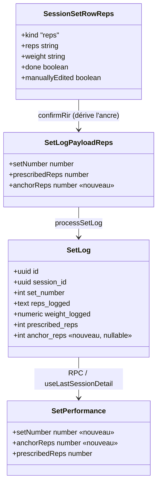
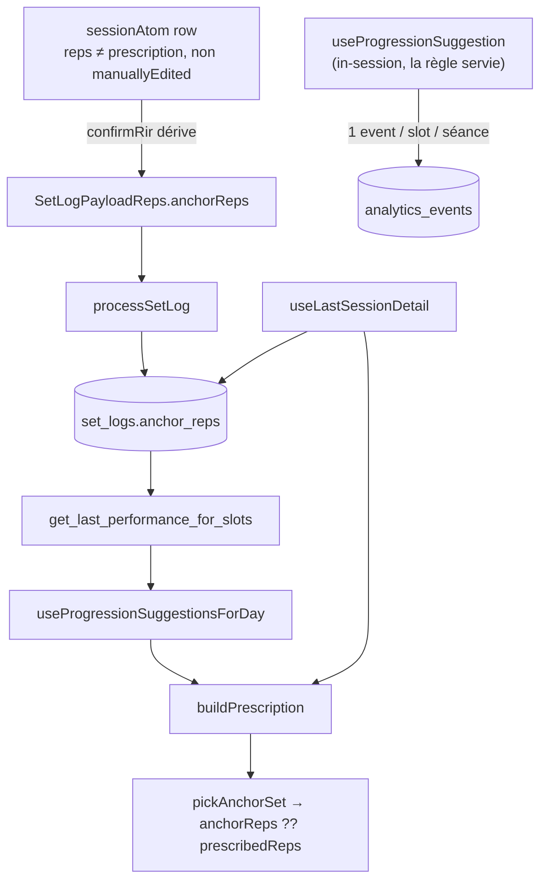

# Tech Plan — Fermeture de la boucle de progression intra→inter-séance

## Architectural Approach

### Key Decisions

| Décision | Choix | Rationale |
|---|---|---|
| Porteur de l'ancre | **dérivée au log** : `anchorReps = reps du row si ≠ prescription verrouillée et non `manuallyEdited`` | pas de champ de row ni de stamp : la règle tient en une comparaison, et `manuallyEdited` exclut à lui seul un « miss » |
| Site de calcul | `confirmRir` (`file:src/components/workout/SetsTable.tsx`), au moment du payload | la cascade (`:566-570`) déplace bien les rows, mais l'auto-apply (`:207-299`) applique le pristine — comparer à la prescription verrouillée sépare les deux sans traçage |
| Persistance | colonne additive `set_logs.anchor_reps integer` | garde `prescribed_*` pristine (baseline observatoire, règle unique `CONTEXT.md`) |
| Lecture | `anchor_reps ?? prescribed_reps` sur la série au `set_number` max | les deux lecteurs ordonnent les séries à l'envers — l'ordre ne doit pas compter |
| Édition manuelle | **exclue automatiquement** (`updateField` pose `manuallyEdited`, que la dérivation refuse) | l'intention de l'athlète reste souveraine, sans code d'effacement |
| Axe poids | inchangé (lit `weight_logged`) | précédent #381 |
| Métriques | émises vers `analytics_events`, couture **in-session** | le moteur est client-only, la règle n'est jamais persistée ; une seule couture évite le double comptage |
| Forme de l'événement | un seul `event_type = 'progression_rule_served'`, la règle dans le payload | un seul type à maintenir quand l'enum `ProgressionRule` évolue |
| Métriques (b) et (c) | **dérivées en SQL** depuis les événements de règle | pas d'événements dédiés ; même patron que l'observatoire (agrégat manuel) |
| Trace | ADR `file:docs/adr/0032-progression-anchor-reps.md` | pourquoi une ancre additive plutôt qu'un écrasement |

### Critical Constraints

- **`prescribed_*` jamais écrasé.** La requête 3 de l'observatoire de déviations
  (`file:docs/Observatory_—_Deviations.md:54-84`) et la règle unique de `file:docs/CONTEXT.md`
  (**Prescription Snapshot**) en dépendent. #381 est le précédent du bug d'un tel écrasement
  (`file:src/lib/progression.ts:173-189`).
- **L'ancre ne se lit jamais par `lastPerformance[0]`.** `useLastSessionDetail` trie les séries en
  `logged_at DESC`, la RPC en `set_number ASC` (`file:supabase/migrations/20260808115507_fix_slot_rpc_rir_cast.sql:82`).
  `file:src/lib/progression.ts:161` lit `[0]` aujourd'hui — inoffensif tant que `prescribed_*` est
  constant sur la séance, faux dès qu'une ancre s'ajoute.
- **Aucun writeback du template en fin de séance** (retiré par ADR 0006, `file:src/lib/syncService.ts:1257`).
- **L'ancre est dérivée au log, pas stampée sur le row.** `prescriptionForLog` vient de
  `lockedPrescriptionRef` (`file:src/components/workout/SetsTable.tsx:146-163`), de la mémoire pure —
  mais la comparaison se fait au moment du payload, donc rien ne dépend de la survie du ref.
- **RPC.** Ajouter une colonne à `RETURNS TABLE` = `CREATE OR REPLACE`. Trois versions existent ; la
  « live » est `file:supabase/migrations/20260808115507_fix_slot_rpc_rir_cast.sql` (en-tête *« never
  committed »*). Le nouveau `CREATE OR REPLACE` part du corps de cette version.
- **Pas de codegen.** `file:src/types/database.ts` est écrit à la main ; à éditer seulement parce qu'un
  consommateur lit la colonne. `createClient` n'est pas typé par le schéma (`file:src/lib/supabase.ts:33`).

---

## Data Model



```sql
-- nouvelle migration : supabase/migrations/2026…_progression_anchor_reps.sql
ALTER TABLE public.set_logs ADD COLUMN anchor_reps integer;

-- get_last_performance_for_slots : ajouter `anchor_reps` au RETURNS TABLE
-- et au SELECT (corps repris de 20260808115507_fix_slot_rpc_rir_cast.sql).
```

### Table Notes

- `anchor_reps` est **nullable**, **sans backfill** : une ligne legacy (NULL) retombe sur
  `prescribed_reps` — comportement d'aujourd'hui.
- Pas de `CHECK` : un entier positif ou NULL, comme `prescribed_reps`.
- L'ancre **coexiste** avec le snapshot pristine sur la même ligne ; elle ne le remplace jamais.
- `analytics_events` n'est pas modifiée : elle existe déjà (`event_type`, `user_id`, `payload`),
  insertion client sous RLS, sans policy de SELECT (lecture en SQL out-of-band).

---

## Component Architecture

### Layer Overview



### New Files & Responsibilities

| File | Purpose |
|---|---|
| `supabase/migrations/2026…_progression_anchor_reps.sql` | colonne `anchor_reps` + `CREATE OR REPLACE` de la RPC |
| `src/lib/progressionRuleTelemetry.ts` | émettre un événement `progression_rule_served` dans `analytics_events` ; jamais d'erreur remontée à l'appelant |
| `src/test/setLogsAnchor.arch.test.ts` | invariant : la colonne existe et la RPC l'expose (comble le trou : rien ne couvre la RPC aujourd'hui) |
| `docs/adr/0032-progression-anchor-reps.md` | l'ADR de la décision |

**Modifiés :** `src/lib/progression.ts` (`pickAnchorSet` + lecture), `src/lib/sessionSetRow.ts`
(`anchorReps`), `src/lib/syncService.ts` (payload `SetLogPayloadReps` + `processSetLog`),
`src/components/workout/SetsTable.tsx` (stamp à la cascade, effacement à l'édition manuelle, port dans
le payload), `src/hooks/useLastSessionDetail.ts` + `useProgressionSuggestionsForDay.ts` (`setNumber` +
`anchorReps` dans `SetPerformance`), `src/hooks/useProgressionSuggestion.ts` (appel télémétrie),
`src/types/database.ts` (`SetLog.anchor_reps`).

### Component Responsibilities

**`buildPrescription`** (`file:src/lib/progression.ts`)
- Ajoute `pickAnchorSet(sets)` : la série au `setNumber` max (fallback premier élément sans
  `setNumber`, legacy).
- Cible reps : `anchorReps ?? prescribedReps`, **uniquement** sur le chemin snapshot (Manual Override
  Window gagne toujours). `prescribedSets`, axe durée et axe poids inchangés.

**`SetsTable`** (`file:src/components/workout/SetsTable.tsx`)
- `confirmRir` : **dérive** l'ancre — `anchorReps = reps du row si ≠ prescriptionForLog.reps et non
  `manuallyEdited`, sinon null` — et la porte dans `SetLogPayloadReps`.
- Aucun autre point de contact : la cascade (`:566-570`) déplace les rows, l'édition manuelle pose
  `manuallyEdited`, et la dérivation au log lit les deux sans traçage ni effacement.

**`useLastSessionDetail`** / **`useProgressionSuggestionsForDay`**
- Mappent `set_number → setNumber` et `anchor_reps → anchorReps` dans `SetPerformance` (les deux, pour
  que la lecture soit indépendante de l'ordre du tableau).

**`progressionRuleTelemetry`** (nouveau)
- Un événement par slot et par séance, depuis la couture in-session uniquement.
- Payload : `{ rule, volumeType, workoutExerciseId, exerciseId, sessionId }`. Aucun email, aucune note.
- Émission best-effort : une erreur d'insertion ne remonte jamais à l'UI.

### Metric read path (dérivé en SQL, patron observatoire)

```sql
-- (a) distribution des règles servies
select payload->>'rule' as rule, count(*) as n
from analytics_events
where event_type = 'progression_rule_served'
group by 1 order by n desc;

-- (b) longueur des runs HOLD_INCOMPLETE  et  (c) PLATEAU jamais résolus :
-- window function sur la suite d'événements par slot (partition workoutExerciseId,
-- ordre created_at) — runs consécutifs, et slots dont le dernier événement est PLATEAU.
```

### Failure Mode Analysis

| Failure | Behavior |
|---|---|
| Pas d'ancre (legacy, ou séance sans décharge) | retombe sur `prescribed_reps` — comportement d'aujourd'hui |
| Édition manuelle après un move moteur | ancre effacée → la valeur de l'athlète gagne |
| Refresh en pleine séance | les rows déjà loggés gardent leur ancre (`sessionAtom`) ; seule la prescription en ref est perdue |
| Skew de déploiement (colonne pas encore migrée) | le hook lit `undefined` → retombe sur `prescribed_reps` |
| Règle émise deux fois (batch + in-session) | évité : une seule couture (in-session) |
| Insert `analytics_events` en échec (hors-ligne) | avalé, aucune erreur UI ; la mesure est perdue pour cette séance, pas la progression |

---

## i18n contract

Aucune nouvelle chaîne utilisateur — l'ancre est invisible et la télémétrie n'est pas de l'UI.
