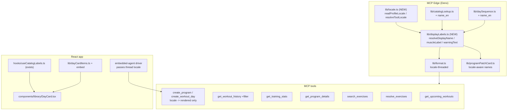

# Tech Plan — Locale end-to-end (#729)

## Architectural Approach

### Key Decisions

| Decision | Choice | Rationale |
|---|---|---|
| Name resolution rule | `name_en` (EN reader) → `name` → `name_snapshot` | ADR 0010, already the client rule in `file:src/lib/catalogLabels.ts` |
| Where resolution happens | **Display time**, both sides: a server helper for MCP, the existing client hook for React | ADR 0010 invariant: snapshots stay frozen |
| MCP `locale` argument | Optional on **every** name-emitting tool (read + write); precedence explicit → profile seed → `en` | The dry-run `rendered` echo is a display string; an EN agent must be able to ask for it |
| `locale` on a write tool | Drives only the `rendered`/preview echo; stripped before persistence, never localizes a snapshot | Same discipline as `patchOnly()` (`file:supabase/functions/mcp/tools/updateProgram.ts`) |
| Embedded preview | The driver passes the thread locale to `create_program`, so `rendered` comes back correct; no client re-render | Minimal change; keeps `extractRenderedFromMcpResult` untouched |
| `muscle_group` | DB values **unchanged**; MCP **output** localized via a server label map | App already localizes via `en/catalog.json`; only MCP leaks. Avoids the 11-migration blast radius (see Stress-Test 6) |
| Search ranking | Add a **defaulted** `locale` param to `search_exercises` / `resolve_exercises_batch`; reorder the `CASE` boost | Precedent: `file:supabase/migrations/20260506004927_resolve_exercises_batch_cap_size.sql` |
| Warnings | **Both layers**: the typed `warning_details` composed in the view by locale (extends #677) **and** the tool's markdown `warnings[]` localized server-side via `warningText` for non-UI clients | ADR 0031 §Amendment keeps French `warnings[]` for non-UI clients today — that is the leak |
| i18n default | No code change — already `detectLocale(navigator.language) ?? "en"` | Fix only the stale `CONTEXT.md` **Display Locale** prose |
| Guard | **Golden fixtures per surface** asserting zero French for an `en` caller | ADR 0010's invisible-failure mode needs a real catcher |

### Critical Constraints

- **`name_snapshot` / `exercise_name_snapshot` are never localized** (ADR 0010). The six write paths are untouched for names; only the display helper changes.
- **RPC signatures are public** (PostgREST-callable, `SECURITY INVOKER`). Any new param needs a `DEFAULT` or named callers break.
- **The MCP tool contract is public** (AGENTS.md): new optional `locale` + `SKILL.md` update = ADR + tests.
- **The server has no i18n dictionary.** `src/locales/*.json` is not reachable from Deno Edge, so the MCP layer needs its own tiny label table (muscles + two warnings + the AMRAP gloss).
- **Migration history is immutable** — the drift guard (`npm run db:drift`) forbids editing an applied migration; RPC changes land in a new file.

---

## Data Model

No schema change. One RPC signature change, applied via a **new** migration:

```sql
create or replace function public.search_exercises(
  search_term text default '',
  filter_muscle_group text default null,
  filter_equipment text default null,
  filter_difficulty text default null,
  page_offset int default 0,
  page_limit int default 25,
  locale text default 'en'
) returns table (...) language sql security invoker as $$
  ...
  -- CASE boost, locale-aware:
  --   locale = 'en' → name_en ranks 0, name ranks 1
  --   locale = 'fr' → name ranks 0, name_en ranks 1
  -- similarity tiebreak unchanged (already symmetric FR/EN)
$$;
```

`resolve_exercises_batch` mirrors it (`locale text default 'en'`). `get_exercise_filter_options`
is dynamic — untouched. Existing PostgREST callers keep working through the defaults.

### Table Notes

No schema change; the only data-layer edit is the `search_exercises` /
`resolve_exercises_batch` signature (a defaulted `locale text` param), applied in a new
migration as the drift guard requires.

---

## Component Architecture

### Layer Overview



### New Files & Responsibilities

| File | Purpose |
|---|---|
| `supabase/functions/mcp/lib/locale.ts` | `readProfileLocale(supabase)`; `resolveToolLocale(args, profile)` reusing `resolveCardLocale` from `file:supabase/functions/mcp/lib/sessionCard.ts` |
| `supabase/functions/mcp/lib/displayLabels.ts` | `resolveDisplayName(exercise, locale)`, `muscleLabel(value, locale)`, `warningText(kind, locale, vars)` — the server twin of `file:src/lib/catalogLabels.ts` |
| `supabase/migrations/{ts}_search_and_resolve_locale.sql` | Redefines the two RPCs with the defaulted `locale` param |

### Component Responsibilities

**`displayLabels.ts`** — pure. `resolveDisplayName` mirrors `sessionCard.ts:256`
(`locale === "fr" ? name : name_en ?? name`) and adds the `name_snapshot` fallback in the
same order as `resolveExerciseName`. `muscleLabel` maps the 13 canonical FR values to their
EN pairs (identical to `file:src/locales/en/catalog.json`), passthrough otherwise (legacy
`"Deltoïdes post."`). `warningText` carries the EN/FR pairs for the two warnings.

**`locale.ts`** — one `user_profiles.select("locale").maybeSingle()` per tool call (the
pattern already used by `file:supabase/functions/mcp/tools/renderSessionCard.ts:42`). No
auth refactor, no third `handler` argument. `resolveToolLocale` returns
`asCardLocale(args.locale) ?? asCardLocale(profile.locale) ?? "en"`.
**Accepted cost:** one extra profile read per name-emitting tool call; no caching in v1
(the row is RLS-scoped, single-row, and already read twice in prod paths today).

**`format.ts`** — `displayExerciseName` (`:392`), `formatWorkoutDay` (`:531`),
`formatSoloDetailsLine` (`:456`), `formatWorkoutHistory` (history formatters),
`formatStatsSummary` (`:350`), `formatAmrapScoreLines` (`:206`), and the update/create
dry-run renderers `renderParsedLine` (`:709`) / `renderCurrentLine` (`:746`) take a `locale`
(default `"en"`); the AMRAP FR gloss renders only for `fr`; `formatStatsSummary` uses
`muscleLabel`. `formatActiveCycleWarning` (`:645`) and `formatSlotDetachmentWarning` (`:657`)
are replaced by `warningText(kind, locale, vars)` for the tool's markdown `warnings[]`.
`file:supabase/functions/mcp/lib/bilingualName.ts` is **retired** for program/history output
in favour of `resolveDisplayName`; its remaining callers (if any) are repointed or deleted in
T711.

**`programPatchCard.ts`** — `soloFromParsed` (`:97`) and `buildUnchangedDay` (`:188`) use
`resolveDisplayName(catalog, locale)`; `warning_details.slot_detachment.exercise` carries the
localized name.

**`create_program` / `create_workout_day`** — accept an optional `locale`, strip it before
persistence (like `patchOnly()`), and thread it only into the dry-run `rendered` echo.
`name_snapshot` still writes the frozen French `name`.

**`dayCardItems.ts` / `DayCard.tsx`** — `DayCardExercise` / `DayCardBlockStation` keep the
`exercise` embed; `toDayCardItems` carries it; `DayCard` renders via
`useCatalogLabels().exerciseName`. `file:src/hooks/useProgramDayCards.ts` widens the
circuit-station select from `exercise:exercises(measurement_type)` to
`exercise:exercises(${LABEL_EXERCISE_SELECT})`.

**Embedded-agent driver** — passes the thread locale into the `create_program` dry-run, so
the `rendered` lines the preview lifts are already language-correct.

**Accepted limitation (issue §E)** — `file:supabase/functions/_shared/programDraft.ts:244`
injects a French `exercise_name_snapshot` into the English LLM prompt as *context only*. The
LLM's output is validated against the catalog (`name_en`), so no French reaches the user. Left
as-is; recorded in ADR 0035.

**`get_workout_history` filter** — matches `exercise_name_snapshot` **or** the joined
`name_en` by locale, so an EN query is not silently dropped.

### Failure Mode Analysis

| Failure | Behavior |
|---|---|
| Read tool called with no `locale` and no profile locale | Falls to `en`; names resolve `name_en` |
| Profile locale NULL (pre-T152 accounts) | Seed skipped → explicit arg or `en` |
| Catalog row absent from payload | `name_snapshot` fallback (French) — unchanged, ADR 0010 |
| Legacy off-taxonomy muscle value | `muscleLabel` passthrough (raw) |
| RPC called without `locale` | `DEFAULT 'en'`; existing callers unaffected |
| `locale` passed to a write tool | Stripped before persistence |
| A surface forgets the helper | Its golden fixture fails in CI |

---

## i18n contract

No new **app** keys — the fix reuses existing `catalog.muscles.*` and surfaces already call
`useCatalogLabels`. New **server-side** strings live in `displayLabels.ts` (not
`src/locales`, unreachable from Deno):

| Kind | EN | FR | Why |
|---|---|---|---|
| muscle | `Chest`, `Back`, `Shoulders`, `Biceps`, `Triceps`, `Quads`, `Hamstrings`, `Glutes`, `Adductors`, `Calves`, `Abs`, `Traps`, `Lower back` | `Pectoraux`, `Dos`, `Épaules`, … | mirror `en/catalog.json` |
| warning active-cycle | `Active cycle since {{date}}` | `Cycle actif depuis {{date}}` | replaces `format.ts:649` |
| warning slot-detachment | `History detached from {{exercise}}` | `Historique détaché de {{exercise}}` | replaces `format.ts:658` |
| AMRAP gloss | `As many rounds as possible.` | `Autant de tours que possible.` | replaces `format.ts:208` |

An assert-based test compares the muscle table to `en/catalog.json` so the two cannot drift.

---

## Stress-Test List

1. **Duplicated muscle table.** The EN pairs are copied from `en/catalog.json`; nothing in the build keeps them in sync. Mitigation: the comparison test above.
2. **`create_program` `locale` must not leak into persisted data.** Enforced by stripping it like `patchOnly()`; a test asserts the persisted patch/payload has no `locale` key.
3. **RPC change vs migration history.** New migration only — editing `20260506004927` fails the drift guard.
4. **The `name_snapshot` fallback still shows French** when the catalog row is absent. Accepted (ADR 0010); no surface can do better without the join.
5. **Golden fixtures can rot.** A surface refactor can move the assertion away from the render path (the existing `ProgramDayRow.test.tsx:87-115` bug). Each fixture must go through the real transformation (`toDayCardItems`, the formatter), not hand-fed English data.
6. **Inconsistency with the Epic Brief:** the brief says "migrate `muscle_group` to English slugs"; this plan deliberately does **not** — the app already localizes muscle labels, so the only leak is MCP output. The ADR must record this reversal and why.
7. **Search ranking still symmetric on similarity.** Only the exact-substring `CASE` boost becomes locale-aware; a fuzzy EN query matching a FR name keeps its similarity rank. Accepted — the audit script ADR 0010 §37 asked for is replaced by a golden fixture.
8. **One profile read per tool call.** `locale.ts` adds a `user_profiles.select("locale")` to each name-emitting tool. Accepted: single-row, RLS-scoped, already done by `update_program`/`render_session_card`. No caching in v1; revisit only if it shows in latency.

---

## Ticket outline (split output: T709–T716)

| Ticket | Maps to |
|---|---|
| T709 | ADR 0035 + SKILL.md + `CONTEXT.md` Display-Locale fix |
| T710 | Catalog `name_en` on the wire + `displayLabels.ts`/`locale.ts` + Decision Card names/warnings + `update_program` markdown `warnings[]` |
| T711 | MCP `locale` on read tools + `format.ts` threading |
| T712 | MCP `locale` on write tools (rendered only, stripped) + embedded preview |
| T713 | `/programs/:id` DayCard embed |
| T714 | `get_workout_history` names + filter |
| T715 | Search/resolve ranking RPC + `locale` |
| T716 | Golden fixtures per surface + muscle-table parity |
