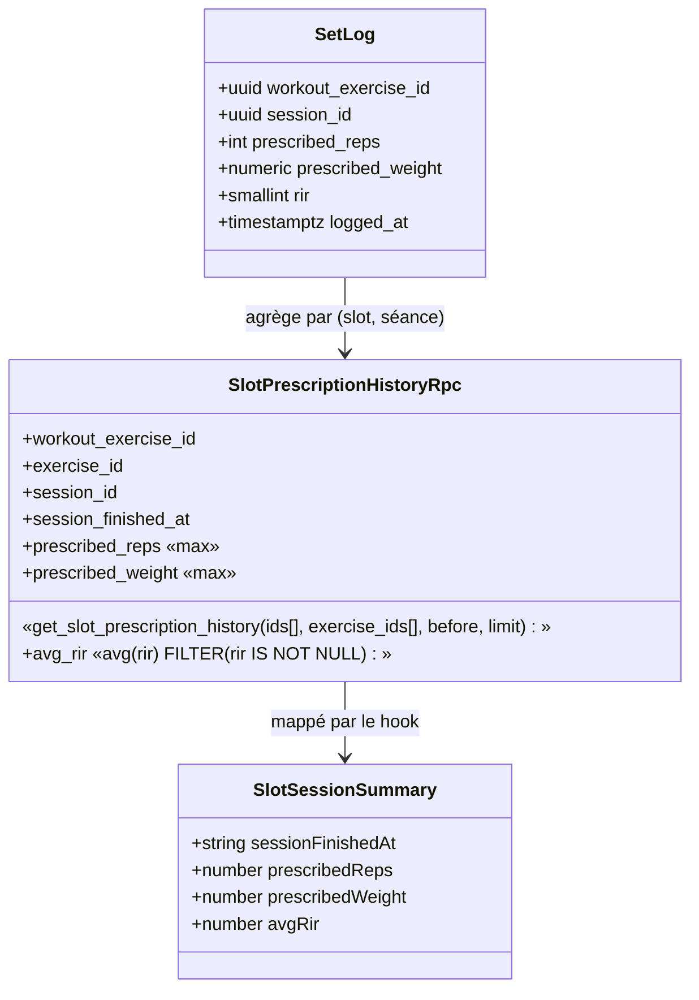
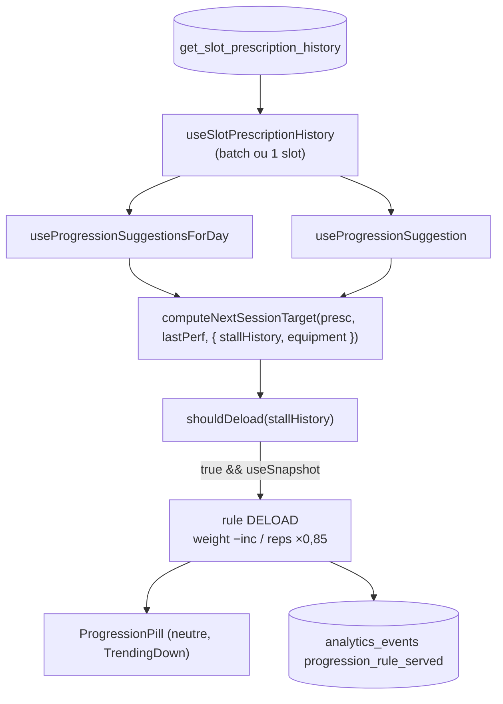

# Tech Plan — Sortie de blocage : décharge planifiée (P2)

## Architectural Approach

### Key Decisions

| Décision | Choix | Rationale |
|---|---|---|
| Read N séances | **Nouvelle RPC agrégée** `get_slot_prescription_history` (1 ligne par slot×séance) | le moteur n'a besoin que du résumé par séance ; ne touche pas la RPC chaude de P1 ; payload borné (`p_limit = 6`) |
| Source du verdict | **Fonction pure** `shouldDeload` dans `file:src/lib/progression.ts` | un seul prédicat, testable, partagé par les deux seams |
| Préemption | **`DELOAD` en early return**, avant l'ordre normal | seul endroit capable de casser une boucle de hold (sinon `HOLD_NEAR_FAILURE` gagne toujours) |
| Effet décharge | weight-first : charge −1 incrément ; reps-only : `max(1, min(round(reps×0.85), reps−1))` | réutilise `PROPORTIONAL_DELOAD_FACTOR` et la forme du moteur intra-session |
| Sortie | **dérivée** : chute de la prescription servie entre les deux dernières séances | aucun état persisté |
| Garde MO window | `DELOAD` **supprimé** si la Manual Override Window est ouverte (`useSnapshot === false`) | l'intention de l'athlète reste souveraine (story 5) |
| Dégradation | RPC absente / en erreur → **pas de décharge**, moteur normal | contrairement à P1 (colonne absente = tout casse), ici on **dégrade** vers le comportement d'aujourd'hui |
| Pastille | style **neutre** existant (muted) + icône `TrendingDown` | « ni une erreur, ni une victoire » ; PLATEAU a déjà ce style |
| Trace | ADR `file:docs/adr/0033-plateau-exit-triggered-by-prescription-stall.md` | déjà écrit |

### Critical Constraints

- **`prescribed_*` reste pristine** (observatoire de déviations, CONTEXT règle unique) — la nouvelle RPC
  ne fait que **lire**.
- **Les deux seams doivent s'accorder.** `useProgressionSuggestionsForDay` (pré-séance, batch) et
  `useProgressionSuggestion` (in-session, un slot) appellent la **même** `shouldDeload` sur la **même**
  RPC. In-session, `p_before = sessionStartedAt` exclut la séance live (cohérent avec
  `useLastSessionDetail.ts` qui filtre `logged_at < sessionStartedAt`).
- **La RPC reprend la notion de « dernière séance » de l'existante** : ordre `logged_at DESC`, jointure
  `sessions`, RLS par `s.user_id = auth.uid()` (SECURITY INVOKER). Pas de filtre `finished_at` (comme
  `get_last_performance_for_slots`), la borne temporelle est portée par `p_before`.
- **RPC neuve** : `CREATE FUNCTION`, pas de `DROP`/`CREATE` sur une RPC existante (aucune signature ne
  change). `GRANT EXECUTE … TO authenticated`.
- **Import `progression.ts → rirSuggestion.ts`** (`getAdjustmentTier`, `PROPORTIONAL_DELOAD_FACTOR` à
  exporter) : pas de cycle (`rirSuggestion.ts` n'importe que des types).
- **Axe durée exclu** : la RPC filtre `sl.duration_seconds IS NULL`.
- **`computeNextSessionTarget` change de signature** (3ᵉ argument optionnel) — les deux appelants et
  leurs tests sont mis à jour ; les tests existants passent `undefined` et gardent leur comportement.

---

## Data Model

Aucune table, aucune colonne. Une **RPC de lecture** neuve.



```sql
-- supabase/migrations/20261021120000_slot_prescription_history.sql
CREATE FUNCTION public.get_slot_prescription_history(
  p_workout_exercise_ids uuid[],
  p_exercise_ids uuid[],
  p_before timestamptz DEFAULT now(),
  p_limit int DEFAULT 6
)
RETURNS TABLE (
  workout_exercise_id uuid, exercise_id uuid, session_id uuid,
  session_finished_at timestamptz, prescribed_reps integer,
  prescribed_weight numeric, avg_rir numeric
)
LANGUAGE plpgsql STABLE SECURITY INVOKER SET search_path = public
AS $$
BEGIN
  IF cardinality(p_workout_exercise_ids) IS DISTINCT FROM cardinality(p_exercise_ids) THEN
    RAISE EXCEPTION 'get_slot_prescription_history: parallel arrays length mismatch (% vs %)',
      cardinality(p_workout_exercise_ids), cardinality(p_exercise_ids)
      USING ERRCODE = 'invalid_parameter_value';
  END IF;

  RETURN QUERY
  WITH slots AS (
    SELECT * FROM unnest(p_workout_exercise_ids, p_exercise_ids)
      AS t(workout_exercise_id, exercise_id)
  ),
  per_session AS (
    SELECT sl.workout_exercise_id, sl.exercise_id, sl.session_id,
      max(sl.logged_at)                 AS last_logged_at,
      max(s.finished_at)                AS session_finished_at,
      max(sl.prescribed_reps)           AS prescribed_reps,
      max(sl.prescribed_weight)         AS prescribed_weight,
      avg(sl.rir) FILTER (WHERE sl.rir IS NOT NULL) AS avg_rir
    FROM set_logs sl
    JOIN sessions s ON s.id = sl.session_id
    JOIN slots sp ON sp.workout_exercise_id = sl.workout_exercise_id
                 AND sp.exercise_id = sl.exercise_id
    WHERE s.user_id = auth.uid()
      AND sl.block_exercise_id IS NULL
      AND sl.workout_exercise_id IS NOT NULL
      AND sl.duration_seconds IS NULL
      AND sl.prescribed_reps IS NOT NULL
    GROUP BY sl.workout_exercise_id, sl.exercise_id, sl.session_id
  ),
  recent AS (
    SELECT per_session.*,
      row_number() OVER (
        PARTITION BY workout_exercise_id, exercise_id
        ORDER BY last_logged_at DESC
      ) AS rn
    FROM per_session
    WHERE last_logged_at < p_before
  )
  SELECT workout_exercise_id, exercise_id, session_id, session_finished_at,
         prescribed_reps, prescribed_weight, avg_rir
  FROM recent
  WHERE rn <= p_limit
  ORDER BY workout_exercise_id, exercise_id, session_finished_at;
END;
$$;

GRANT EXECUTE ON FUNCTION public.get_slot_prescription_history(uuid[], uuid[], timestamptz, int)
  TO authenticated;
```

### Table Notes

- **Une ligne par (slot, séance)**, ordonnée ancien→récent : le client `slice` les N dernières.
- Le filtre `last_logged_at < p_before` est appliqué **avant** le `row_number()` : la fenêtre ne compte
  que les séances antérieures à la borne (pré-séance : `now()` ; in-session : `sessionStartedAt`).
- `prescribed_reps` / `prescribed_weight` = `max` sur les séries de la séance (constantes par séance par
  l'invariant ADR 0006) ; `avg_rir` = moyenne des RIR **déclarés** (jamais imputés).
- `p_limit = 6` : 4 séances pour la fenêtre stagnante + 1 pour détecter la chute de sortie + 1 de marge.
- Pas de `CHECK`, pas de backfill, pas de nouvelle table — la RPC lit l'existant.

---

## Component Architecture

### Layer Overview



### New Files & Responsibilities

| File | Purpose |
|---|---|
| `supabase/migrations/20261021120000_slot_prescription_history.sql` | la RPC + `GRANT` |
| `src/hooks/useSlotPrescriptionHistory.ts` | une lecture pour 1..n slots → `Map<slotKey, SlotSessionSummary[]>` ; erreur → vide (pas de décharge) |
| `src/test/slotPrescriptionHistory.arch.test.ts` | invariant : RPC existe, `SECURITY INVOKER`, `GRANT authenticated`, filtre `user_id = auth.uid()`, filtre axe reps |

**Modifiés :** `file:src/lib/progression.ts` (`DELOAD` + `SlotSessionSummary` + `STALL_SESSIONS` +
`shouldDeload` + branche `DELOAD` + signature), `file:src/lib/rirSuggestion.ts` (export
`PROPORTIONAL_DELOAD_FACTOR`), `file:src/hooks/useProgressionSuggestionsForDay.ts` +
`file:src/hooks/useProgressionSuggestion.ts` (fetch + passage de `stallHistory`/`equipment`),
`file:src/components/workout/ProgressionPill.tsx` (`ICON_MAP`/`COLOR_MAP`/`APPLIED_RULES`),
`file:src/locales/{en,fr}/workout.json` (2 clés), fixtures de tests
(`progression.test.ts`, `ProgressionPill.test.tsx`, `useProgressionSuggestion.test.ts`).

### Component Responsibilities

**`shouldDeload`** (`file:src/lib/progression.ts`)
- Entrée : `SlotSessionSummary[]` ordonnés ancien→récent.
- `false` si `< 2` séances ; `false` si la dernière transition **chute** (décharge déjà servie) ;
  `false` si `< STALL_SESSIONS` ; `false` si la fenêtre des `STALL_SESSIONS` dernières n'est pas
  non-croissante ; `false` si `avg_rir` de la dernière est `null` ou `> 1`.
- Comparaison du palier : `(weight, reps)` lexicographique — poids d'abord, reps en tie-break
  (couvre le reps-only où `weight = 0`).

**`computeNextSessionTarget`** (`file:src/lib/progression.ts`)
- Nouveau param `opts?: { stallHistory?: SlotSessionSummary[]; equipment?: string }`.
- **En tête**, après le calcul `useSnapshot` : si `useSnapshot && shouldDeload(stallHistory)` →
  `DELOAD` (weight-first : `currentWeight − weightIncrement`, plancher `weightIncrement` ; reps-only :
  `max(1, min(round(volume.current × 0.85), volume.current − 1))`), `delta: "—"`.
- Rien d'autre ne bouge : les règles suivantes gardent leur ordre.

**`useSlotPrescriptionHistory`** (nouveau)
- TanStack Query, clé sur les paires `slot:exercise` triées + `before`. Retourne un `Map`.
- **Erreur ou RPC absente → `Map` vide** : `shouldDeload([]) === false`, aucune décharge, moteur normal.

**`ProgressionPill`** (`file:src/components/workout/ProgressionPill.tsx`)
- `ICON_MAP.DELOAD = TrendingDown`, `COLOR_MAP.DELOAD = bg-muted text-muted-foreground border-border`,
  `APPLIED_RULES` inclut `DELOAD` (hint « Already applied »).

### Failure Mode Analysis

| Failure | Behavior |
|---|---|
| RPC pas encore déployée (skew) | requête en erreur → `Map` vide → aucune décharge (comportement d'aujourd'hui) ; pas de régression bloquante, l'ordre reste migration→client |
| < `STALL_SESSIONS` séances | `shouldDeload` false → pas de décharge |
| Aucun RIR déclaré | `avg_rir` `null` → pas de décharge (« signal indisponible ≠ 0 ») |
| Manual Override Window ouverte | `useSnapshot === false` → pas de décharge ; l'édition manuelle gagne |
| Séance live dans la fenêtre | exclue par `p_before` |
| Baisse manuelle de charge (athlète) | lue comme « chute » → pas de décharge (sous-déclenche, ne boucle jamais) |
| Slot Quick Workout / nouveau slot (ADR 0030) | < N séances → bootstrap, pas de décharge |

---

## i18n contract

**Namespace:** `workout` (déjà utilisé par le pill)
**Surfaces:** `ProgressionPill` — pré-séance (compact, icône seule + `aria-label`) et in-session (pill complet + popover).

| Key | EN | FR | Why this wording |
|---|---|---|---|
| `progression.deload` | Deload | Décharge | terme CONTEXT (UI), 1 mot pour le badge |
| `progression.deloadDetail` | Your target hasn't moved in a while and you're training close to failure. A lighter session to recover — just this once. | Ta cible ne bouge plus depuis un moment et tu t'entraînes proche de l'échec. Séance plus légère pour récupérer — juste cette fois. | explique le *pourquoi* (stagnation + saturation) et la sortie (une seule séance) sans citer `N` (réglable) |

### Rejected
- `progression.deload` FR `Semaine de décharge` — trop long pour un badge, et un grain faux (une séance, pas une semaine).
- EN `Lighter week` — même erreur de grain.
- `…since 4 sessions…` — fige le seuil `N` dans la copie, qui est réglable.

### Open
- Le badge nu « Deload » / « Décharge » suppose le lecteur à l'aise avec le terme ; le popover le
  contextualise. Pas de gloss parentétique faute de place en mode compact (icône seule).
